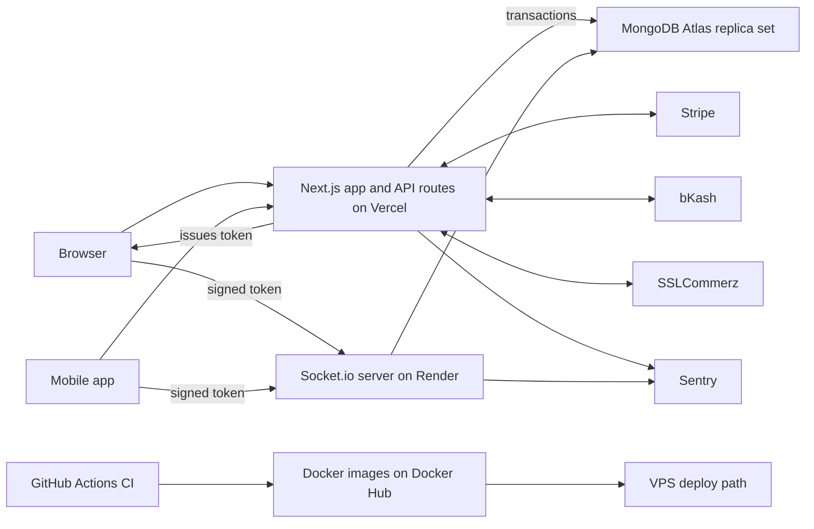

# ⚡ TaskHub — Micro-Task & Earning Platform


> A production-style SaaS platform connecting Buyers who need small online tasks done with Workers who earn coins by completing them. Features a full coin economy, Stripe payments, real-time Socket.io messaging & notifications, and role-based dashboards — built to demonstrate real-world full-stack architecture.

---

## 🎯 Project Overview

TaskHub is a comprehensive micro-task marketplace where Buyers post tasks (watch a video, write a review, test an app, do research) and Workers earn coins by completing them. Workers and Buyers can communicate directly through a built-in real-time chat system powered by Socket.io — conversations are scoped to tasks, with typing indicators, read receipts, and persistent message history.

The platform runs on a transparent coin economy — Buyers purchase coins to fund tasks, Workers earn coins on approval and cash out via withdrawal requests.

Unlike a basic CRUD app, TaskHub is designed as a production-style SaaS:

- **3 distinct user roles** with real-world responsibilities and separate dashboards
- **Real-time messaging** — Socket.io direct chat between Workers and Buyers, scoped to tasks, with typing indicators and read receipts
- **Live notifications** — bell icon with unread badge, action routing, and server-side triggers on key events
- **Coin economy with monetization logic** — buy rate vs withdrawal rate spread is the platform's revenue
- **Secure auth** with Google OAuth and email/password via NextAuth v5
- **Real payment integration** via Stripe Checkout with webhook verification
- **Admin panel** with advanced analytics, charts, and full platform management
- **Public leaderboard** showing top earners ranked by approved coins
- **Fully responsive** — mobile, tablet, and desktop layouts throughout

---

## 🧱 Engineering

TaskHub moves real money, so most recent work went into making coin flows correct under load, and into tests, monitoring and deployment. This section shows what was found, how it was fixed and how each fix is checked.

### Architecture



The web app and its API routes run on Vercel and talk to MongoDB Atlas. Atlas runs as a replica set, so money flows use multi-document transactions. Chat runs in a separate Socket.io server on Render. The browser first asks `/api/v1/socket-token` for a signed token that lasts 10 minutes, then joins the chat server with it. Stripe, bKash and SSLCommerz are used for coin purchases, and Sentry receives errors from the web app, the worker and the chat server. CI lints, tests and builds every push and builds the Docker images. On a push to `main`, an optional job publishes the images and deploys them to a VPS. It stays off until the repository secrets are set. See [ADR 0001](docs/adr/0001-vps-deployment.md).

### Problems found and fixed

| Problem | Fix | How it's proven | PR |
| ------- | --- | --------------- | -- |
| Anyone could pretend to be another user in chat. The chat server trusted a user ID sent by the client, and any socket could join any conversation. | The chat server now checks a signed, short-lived token and only lets the two people in a conversation join, send, type or mark messages read. | Tests for token signing and checking and for the conversation rules (`src/lib/socket-token.test.ts`, `server/test/`), run in CI. | [#2](https://github.com/masumislambadsha/taskhub/pull/2) |
| Any signed-in user could read the chat history of a conversation that had no messages yet. | The history route now checks that the caller is one of the two people in the conversation. It returns 400 for a malformed ID and 403 for anyone else. | Tests for the conversation ID helpers (`src/lib/conversation.test.ts`). | [#4](https://github.com/masumislambadsha/taskhub/pull/4) |
| Payments: a user could get free coins by calling confirm without paying. One SSLCommerz receipt could credit several payments. Two callbacks at once could credit twice. bKash merchant tokens were handed to anyone who asked, and some payment routes needed no login. A failed-payment redirect could block someone else's payment. | One function, `creditPayment`, is the only place that adds purchased coins. It checks the provider's answer, the amount and the currency, and credits once inside a transaction. Unique indexes stop a receipt from being used twice. The unsafe bKash and SSLCommerz routes were deleted, and the SSLCommerz fail route now only redirects. | `src/lib/payments/*.test.ts`. Ten concurrent credits for one payment give one credit. Reused receipts, wrong amounts and the fail route are covered too. | [#5](https://github.com/masumislambadsha/taskhub/pull/5) |
| Coins could be spent twice, a buyer could raise a task's payout and then delete the task for a bigger refund, a submission could be paid twice, withdrawals could be overdrawn, and a double sign-up gave two bonuses. There was no coin history. | A double-entry coin ledger. Every coin movement is one journal entry, written in the same transaction as the balance change. Users get a coin history page. See [ADR 0002](docs/adr/0002-coin-ledger.md). | `src/lib/ledger/**/*.test.ts`. 20 parallel task creations from a buyer who can afford 2 give exactly 2. The tests also cover 10 parallel approvals, parallel withdrawals, the payout edit and double sign-up. A randomized test checks the ledger rules after every step. | [#8](https://github.com/masumislambadsha/taskhub/pull/8) |
| Every bKash payment asked bKash for two new tokens. | The bKash grant token is reused for 50 minutes and shared by all serverless instances through one MongoDB document. A 401 from bKash clears it and the request is retried once. | 7 tests in `src/lib/bkash.test.ts`: reuse, expiry at 50 minutes, a second instance, concurrent calls, one retry on a 401, and a failing token store. | [#9](https://github.com/masumislambadsha/taskhub/pull/9) |
| Two workers could take the last task slot at once, and one worker could submit twice at once. A task ID that was not a valid ObjectId was passed into the query. | `submitWork` takes the slot with a conditional update inside one transaction, and the route refuses a task ID that is not an ObjectId. | `src/lib/ledger/flows/submissions.test.ts`. 10 parallel submissions on 5 slots give exactly 5. One worker submitting 5 times at once gets 1. Bad IDs are refused. | [#10](https://github.com/masumislambadsha/taskhub/pull/10) |
| Lint errors were ignored in CI. | The lint errors were fixed without turning rules off, and the CI lint step now fails the build on errors. | `npm run lint` reports 0 errors (19 warnings remain). The CI Lint step runs before the tests. | [#11](https://github.com/masumislambadsha/taskhub/pull/11) |

### Testing

- **Count:** 229 tests. 210 are in the web app (`npm test`, 20 files) and 19 are in the chat server (`cd server && npm test`).
- **Real database:** integration tests run against a real MongoDB replica set started by `mongodb-memory-server`. One instance is shared by all test files in a run, so transactions behave as they do on Atlas. Set `MONGODB_TEST_URI` to use an existing database instead.
- **Concurrency tests:** the money flows are tested with parallel calls: credits, task creation, approvals, withdrawals, deletes, sign-ups and submissions. The tests check how many calls succeed and that the totals still add up.
- **Randomized ledger test:** `src/lib/ledger/invariants.test.ts` runs seeded random sequences of coin operations and checks that the balances match the journal after each step. A failing run prints its seed, so it can be replayed.
- **Run them:**

```bash
npm test                    # web app, 210 tests
cd server && npm test       # chat server, 19 tests
npm run typecheck           # TypeScript
npm run lint                # ESLint
```

### Operations

- **Health checks:** `GET /api/health` answers while the process is up. `GET /api/health/ready` checks MongoDB, and Redis when `REDIS_URL` is set, and returns 503 if a check fails. Both report a version taken from the deploy commit SHA, and the responses never include error details.
- **Logs:** structured JSON logs with pino. Route handlers log one line per request with a request ID, which comes from the `x-request-id` header (set by Nginx) or is generated, and is returned in the response. Passwords, tokens and cookies are redacted.
- **Errors:** Sentry is set up for the web app, the background worker and the chat server. It does nothing when no DSN is set.
- **CI** (`.github/workflows/ci.yml`): lint (errors fail the build), typecheck, web tests, web build, worker bundle, chat server check and tests, then Docker builds of the web, worker and chat server images. On `main`, an optional job pushes the images to Docker Hub and deploys them over SSH.
- **Ledger reconcile:** `npm run ledger:reconcile`, or the admin route `GET /api/v1/admin/ledger/reconcile`, recomputes every balance from the journal and compares it with the stored balance. It also checks that the journal adds up to zero and that no user or task escrow is negative. It returns IDs and amounts only.

### Design docs

- [ADR 0001: VPS deployment](docs/adr/0001-vps-deployment.md)
- [ADR 0002: Coin ledger](docs/adr/0002-coin-ledger.md)
- [ROADMAP](ROADMAP.md)

---

## ✨ Key Features

### For Workers:

- 🔍 Browse and filter tasks by keyword, payout amount, category, and deadline
- 📝 Submit proof with text details, multiple proof links, and optional image upload via imgBB
- 📊 Track all submissions by status — pending, approved, rejected — with paginated history
- 💰 View available coin balance, pending clearance coins, and lifetime earnings in USD
- 🏧 Request withdrawals once balance hits 200 coins minimum (≈ $10 USD)
- 📈 Personal earnings portal with full transaction history (earnings + withdrawals combined)
- 💬 Direct real-time messaging with Buyers, linked to specific tasks
- 🔔 Live notification bell with unread count — get notified on approvals, rejections, and withdrawal status
- 🏆 Appear on the public leaderboard ranked by total approved coins
- 👤 Profile page with stats, badges, and submission history
- ⚙️ Settings page for account preferences

### For Buyers:

- 📋 Create tasks with title, description, category, required worker count, coin payout per worker, deadline, submission instructions, and task image
- 💡 Automatic coin deduction on task creation — total cost = requiredWorkers × payableAmount
- 👀 Review worker submissions one by one — view full proof details, links, and images
- ✅ Approve submissions to credit worker coins instantly
- ❌ Reject submissions to free up the worker slot for re-submission
- 📊 Dashboard with task activity chart (7-day bar chart), approval rate, and submission breakdown
- 🪙 Purchase coins via Stripe, bKash, or SSLCommerz with 4 package tiers
- 📜 Full payment history with gateway, coins, amount, and transaction ID
- 💬 Direct real-time messaging with Workers, linked to task context
- 🔔 Notifications for new submissions and platform events
- ✏️ Edit task title, description, and instructions after creation
- 🗑️ Delete open tasks with automatic coin refund for unfilled slots

### For Admins:

- 👥 Manage all users — view, update roles, suspend/activate, delete accounts
- 📋 Manage all tasks — view details, block fraudulent or inappropriate tasks
- 📬 Process withdrawal requests — approve (deducts worker coins) or reject with notification
- 💵 View all platform payments with gateway breakdown and transaction details
- 📊 Advanced analytics dashboard with date range filtering (7d, 30d, 90d, custom)
- 📈 Revenue trend line chart, task volume bar chart, category split donut chart
- 🔁 Submission funnel visualization (submitted → approved → rejected → pending)
- 💳 Payment gateway breakdown showing revenue split across Stripe, bKash, SSLCommerz
- 🏆 Top workers by earnings in selected period
- 🧾 Recent payments feed with user, gateway, coins, and amount
- 🗂️ Category management
- 📋 Activity log for platform-wide event tracking
- 🩺 Platform health panel — coin circulation, pending withdrawals, pending submissions

---

## Run locally with Docker

Needs Docker with Compose v2.

1. Copy the env file and fill in the secrets you need (at least `NEXTAUTH_SECRET`):

   ```bash
   cp .env.example .env
   ```

2. Build and start everything (Nginx, web, realtime, worker, MongoDB, Redis):

   ```bash
   docker compose up -d --build --wait
   ```

3. Open http://localhost. Health checks: `/api/health` (liveness) and `/api/health/ready` (MongoDB and Redis).

4. To load development data, publish the database ports with the dev override and run the seed script from your machine:

   ```bash
   docker compose -f compose.yml -f compose.dev.yml up -d --wait mongo redis
   MONGODB_URI="mongodb://localhost:27017/taskhub?directConnection=true" npm run seed
   ```

   The seed creates `admin@seed.taskhub.local`, `buyer1@` to `buyer3@` and `worker1@` to `worker10@` (same domain), all with the dev password `TaskHub-dev-1234` (override with `SEED_PASSWORD`). It refuses to run against a non-local database or in production.

Stop with `docker compose down` (add `-v` to also delete the database and Redis volumes).

## Deploy to a VPS

Production runs from prebuilt Docker Hub images on a VPS with Nginx on the host, HTTPS from certbot and an SSH deploy job in GitHub Actions. It stays off until the GitHub secrets are added. The full runbook (setup, secrets, first deploy, rollback, switch-over from Vercel and Render) is in [deploy/README.md](deploy/README.md).

---

## 🛠️ Tech Stack

### Frontend:

- **Framework**: Next.js 16 (App Router, Server Components, Route Handlers)
- **Language**: TypeScript (strict mode throughout)
- **Styling**: Tailwind CSS v4 + DaisyUI component library
- **State Management**: TanStack Query v5 (server/async state) + Redux Toolkit (UI state — sidebar, notification panel, modals)
- **Forms**: React Hook Form + Zod validation (client and server)
- **Animations**: Framer Motion (sidebar slide, page transitions) + GSAP (homepage scroll animations) + Lenis (smooth scroll)
- **Charts**: Recharts (revenue line chart in admin analytics)
- **Real-time**: Socket.io client (`socket.io-client`)
- **Notifications**: React Hot Toast + SweetAlert2 (confirmation dialogs)
- **Date utilities**: date-fns
- **Marquee**: react-fast-marquee (trusted brands section on homepage)
- **HTTP client**: Axios

### Backend:

- **Database**: MongoDB Atlas + Mongoose ODM
- **Authentication**: NextAuth.js v5 beta — Credentials provider (email/password) + Google OAuth
- **Session**: JWT sessions with custom callbacks to embed `id`, `role`, `coins` into session
- **Payment**: Stripe Checkout Sessions + Stripe Webhooks, bKash and SSLCommerz. Every gateway credits coins through one function (see Payment Flow)
- **Coin ledger**: double-entry journal in MongoDB transactions (see Coin Economy)
- **File Upload**: imgBB API (proxied through Next.js route handler)
- **Email**: Resend
- **Real-time server**: Separate Express + Socket.io server (deployed on Render), authenticated with short-lived signed tokens
- **Logging and errors**: pino structured logs, Sentry
- **Background worker**: a small Node process (`src/worker`) built as its own Docker image
- **API**: Next.js Route Handlers under `/api/v1/`
- **Password hashing**: bcryptjs

### Dev & Tooling:

- ESLint (Next.js config), blocking in CI
- TypeScript strict mode
- Vitest + `mongodb-memory-server` (web app), Node test runner (chat server)
- Docker and Docker Compose, GitHub Actions CI
- Vercel deployment (frontend)
- Render deployment (Socket.io server)
- Optional VPS deployment from Docker Hub images

---

## 📁 Project Structure

```
taskhub/
├── src/
│   ├── app/
│   │   ├── (public)/
│   │   │   ├── page.tsx                        # Homepage (server component)
│   │   │   ├── tasks/page.tsx                  # Public task listing teaser
│   │   │   ├── leaderboard/page.tsx            # Top earners leaderboard
│   │   │   ├── how-it-works/page.tsx           # Platform explainer
│   │   │   ├── about/page.tsx
│   │   │   ├── faq/page.tsx
│   │   │   ├── terms/page.tsx
│   │   │   ├── privacy/page.tsx
│   │   │   ├── support/page.tsx
│   │   │   └── layout.tsx                      # Public layout (Navbar + Footer)
│   │   ├── (auth)/
│   │   │   ├── login/page.tsx
│   │   │   ├── register/page.tsx
│   │   │   ├── forgot-password/page.tsx
│   │   │   ├── reset-password/page.tsx
│   │   │   └── layout.tsx
│   │   ├── (worker)/
│   │   │   ├── worker/dashboard/page.tsx       # Stats, earnings chart, recent submissions
│   │   │   ├── worker/tasks/page.tsx           # Browse & filter tasks
│   │   │   ├── worker/tasks/[id]/page.tsx      # Task detail + submission form
│   │   │   ├── worker/submissions/page.tsx     # My submissions (paginated, filterable)
│   │   │   ├── worker/earnings/page.tsx        # Earnings portal + transaction history
│   │   │   ├── worker/withdrawals/page.tsx     # Withdrawal form + history
│   │   │   ├── worker/messages/page.tsx        # Real-time chat
│   │   │   ├── worker/profile/page.tsx         # Profile + stats + badges
│   │   │   ├── worker/settings/page.tsx
│   │   │   └── layout.tsx                      # Worker shell + auth guard
│   │   ├── (buyer)/
│   │   │   ├── buyer/dashboard/page.tsx        # Stats, task chart, pending submissions
│   │   │   ├── buyer/tasks/page.tsx            # My tasks table
│   │   │   ├── buyer/tasks/new/page.tsx        # Create task form
│   │   │   ├── buyer/tasks/[id]/page.tsx       # Task detail
│   │   │   ├── buyer/tasks/[id]/edit/page.tsx  # Edit task
│   │   │   ├── buyer/tasks/[id]/success/page.tsx
│   │   │   ├── buyer/submissions/page.tsx      # Review submissions (approve/reject)
│   │   │   ├── buyer/coins/page.tsx            # Purchase coins (Stripe/bKash/SSLCommerz)
│   │   │   ├── buyer/payments/page.tsx         # Payment history
│   │   │   ├── buyer/messages/page.tsx         # Real-time chat
│   │   │   ├── buyer/profile/page.tsx
│   │   │   └── layout.tsx                      # Buyer shell + auth guard
│   │   ├── (admin)/
│   │   │   ├── admin/dashboard/page.tsx        # Platform overview
│   │   │   ├── admin/users/page.tsx            # Manage users
│   │   │   ├── admin/tasks/page.tsx            # Manage tasks
│   │   │   ├── admin/submissions/page.tsx      # All submissions
│   │   │   ├── admin/withdrawals/page.tsx      # Process withdrawals
│   │   │   ├── admin/payments/page.tsx         # Platform payments
│   │   │   ├── admin/stats/page.tsx            # Advanced analytics
│   │   │   ├── admin/categories/page.tsx       # Category management
│   │   │   ├── admin/activity/page.tsx         # Activity log
│   │   │   └── layout.tsx                      # Admin shell + auth guard
│   │   ├── api/
│   │   │   ├── auth/[...nextauth]/route.ts
│   │   │   ├── health/route.ts                 # Liveness
│   │   │   ├── health/ready/route.ts           # Readiness (MongoDB, Redis)
│   │   │   ├── bkash/callback/route.ts         # bKash callback, credits coins
│   │   │   └── sslcommerz/{success,ipn,fail,cancel}/route.ts
│   │   └── api/v1/
│   │       ├── auth/                           # login, register, password reset, mobile token
│   │       ├── tasks/                          # list, create, get, update, delete
│   │       ├── submissions/                    # list, create, approve or reject
│   │       ├── payments/                       # packages, create-session, confirm, history,
│   │       │                                   #   admin-confirm, stripe/webhook
│   │       ├── wallet/transactions/route.ts    # Coin history
│   │       ├── withdrawals/                    # list, create, approve or reject
│   │       ├── notifications/
│   │       ├── messages/                       # conversation list and history
│   │       ├── socket-token/route.ts           # Signed token for the chat server
│   │       ├── admin/                          # stats, users, tasks, categories,
│   │       │                                   #   ledger/open, ledger/reconcile
│   │       └── uploads/imgbb/route.ts
│   ├── components/
│   │   ├── layout/
│   │   │   ├── Navbar.tsx                      # Public navbar
│   │   │   ├── Footer.tsx                      # Public footer
│   │   │   ├── Sidebar.tsx                     # Dashboard sidebar (worker/buyer/admin nav)
│   │   │   └── DashboardShell.tsx              # Dashboard wrapper with topbar
│   │   ├── ui/
│   │   │   ├── Badge.tsx                       # Status badge (pending/approved/rejected)
│   │   │   ├── Spinner.tsx
│   │   │   ├── Logo.tsx
│   │   │   ├── CountUp.tsx                     # Animated number counter
│   │   │   ├── StatsSection.tsx                # Homepage platform stats
│   │   │   ├── CoinPackageCards.tsx            # Homepage coin pricing cards
│   │   │   └── MarqueeBrands.tsx               # Trusted by marquee
│   │   ├── admin/
│   │   │   ├── StatsDateFilter.tsx             # Date range preset selector
│   │   │   ├── RevenueLineChart.tsx            # Recharts line chart
│   │   │   └── ...
│   │   ├── messages/
│   │   │   └── MessagesUI.tsx                  # Full chat UI (conversation list + chat panel)
│   │   ├── notifications/
│   │   │   └── NotificationBell.tsx            # Bell icon with unread badge + dropdown panel
│   │   └── shared/
│   │       └── StatCard.tsx                    # Reusable dashboard stat card
│   ├── lib/
│   │   ├── db.ts                               # Mongoose connection helper
│   │   ├── auth.ts                             # NextAuth config + session callbacks
│   │   ├── coins.ts                            # coinsToUsdWithdraw() utility
│   │   ├── ledger/                             # Double-entry coin ledger (postTransaction, reconcile)
│   │   ├── payments/                           # creditPayment() and gateway verification
│   │   ├── socket-token.ts                     # Signs the chat token
│   │   ├── health.ts, logger.ts                # Health checks, pino logger
│   │   ├── constants.ts                        # COIN_PACKAGES, PAYMENT_GATEWAYS, MIN_WITHDRAWAL_COINS
│   │   ├── notifications.ts                    # createNotification() helper
│   │   ├── statsDateRange.ts                   # Date range resolver for admin analytics
│   │   └── validators/                         # Zod schemas (task, submission, withdrawal)
│   ├── models/
│   │   ├── User.ts
│   │   ├── Task.ts
│   │   ├── Submission.ts
│   │   ├── Payment.ts
│   │   ├── Withdrawal.ts
│   │   ├── Notification.ts
│   │   ├── Message.ts
│   │   ├── Category.ts, Contact.ts, PasswordResetToken.ts
│   │   ├── LedgerTransaction.ts, LedgerAccount.ts
│   │   └── BkashToken.ts
│   ├── store/
│   │   ├── index.ts                            # Redux store
│   │   └── uiSlice.ts                          # sidebarOpen, notificationPanelOpen
│   ├── hooks/
│   │   ├── useSocket.ts                        # Socket.io hook (send, receive, typing)
│   │   └── ...
│   └── types/
│       └── index.ts                            # IUser, ITask, ISubmission, IPayment, IWithdrawal, INotification, IMessage, IConversation
├── server/                                     # Express + Socket.io chat server (own package.json)
│   ├── index.js, socket.js                     # Server and socket events
│   ├── middleware/socketAuth.js                # Verifies the signed token
│   └── test/
├── scripts/                                    # seed, ledger:open, ledger:reconcile
├── docs/adr/                                   # Design decisions
├── deploy/                                     # VPS deploy runbook and scripts
├── .github/workflows/ci.yml                    # CI
└── public/
```

---

## 💬 Real-Time Messaging

TaskHub includes a full Socket.io powered messaging system between Workers and Buyers, scoped to individual tasks.

**Architecture:**

- A separate Express + Socket.io server runs independently (deployed on Render)
- The Next.js frontend connects via `socket.io-client` using a custom `useSocket` hook
- Conversations are identified by a `conversationId` derived from `taskId + buyerId + workerId`
- The browser gets a signed token from `GET /api/v1/socket-token` (valid for 10 minutes, HS256, signed with `SOCKET_JWT_SECRET`) and sends it when it connects. A new token is fetched on every connect and reconnect
- The server takes the user's identity only from the token. A missing, forged or expired token is rejected, and so is every connection if the secret is missing or too short
- Only the two people in a conversation can join it, send, type or mark messages read, and the database must confirm that the task exists and one of them is its buyer. Messages are limited to 2000 characters
- `GET /api/v1/messages/[conversationId]` applies the same membership rule: 400 for a malformed ID, 403 for anyone else

**Features:**

- Conversation list sidebar showing all active chats with last message preview and unread count badge
- Real-time message delivery without page refresh
- Typing indicators — animated bouncing dots appear while the other user is typing, with 1.5s debounce
- Read receipts — single ✓ for sent, double ✓✓ for read
- Messages persist in MongoDB and are fetched via TanStack Query on conversation open
- Auto-scroll to latest message on new incoming messages
- Mobile-responsive — single panel toggle between conversation list and chat view
- Deep-link support — open a specific conversation directly via URL query params (`?conv=&taskId=&otherId=&otherName=`)
- Workers can open a chat from a task detail page; Buyers can open a chat from a submission review

**Socket events:**

- `join:conversation` / `leave:conversation`: enter or leave a conversation room
- `message:send`: emit new message
- `message:receive`: receive incoming message
- `message:error`: a message was refused
- `typing:start` / `typing:stop`: typing indicator events
- `messages:read`: mark conversation messages as read

---

## 🔔 Notification System

Notifications are created server-side whenever key events occur and delivered to the user's bell icon in the dashboard topbar.

**Triggers:**

- Worker submits proof → Buyer receives "New submission on [task]"
- Buyer approves submission → Worker receives "Your submission was approved, +X coins"
- Buyer rejects submission → Worker receives "Your submission was rejected"
- Admin approves withdrawal → Worker receives "Your withdrawal of X coins has been approved"
- Admin rejects withdrawal → Worker receives "Your withdrawal request was rejected"

**UI behaviour:**

- Bell icon shows red badge with unread count (capped at 9+)
- Clicking the bell opens a fixed dropdown panel positioned relative to the button
- Panel shows all notifications sorted newest first, unread items highlighted
- "Mark all read" button clears the badge
- Panel closes on outside click
- Polls every 30 seconds via TanStack Query `refetchInterval`
- Redux manages the open/close state of the panel (`notificationPanelOpen` in `uiSlice`)

---

## 💰 Coin Economy

The coin system is the core business model of TaskHub. It is intentionally asymmetric to generate platform revenue.

| Action                       | Rate                  |
| ---------------------------- | --------------------- |
| Buyer purchases coins        | 10 coins = $1 USD     |
| Worker withdraws coins       | 20 coins = $1 USD     |
| Minimum withdrawal threshold | 200 coins (≈ $10 USD) |
| New Worker signup bonus      | 10 coins              |
| New Buyer signup bonus       | 50 coins              |

**How the platform earns:**
The spread between the buy rate and the withdrawal rate is the platform fee. Example: a Buyer funds a task with 100 coins ($10). A Worker earns those 100 coins and withdraws them for $5. TaskHub keeps the $5 difference — no hidden fees, no commission taken from individual transactions.

**Coin Packages (Buyer purchase):**

| Package | Coins | Price |
| ------- | ----- | ----- |
| Starter | 10    | $1    |
| Basic   | 150   | $10   |
| Pro     | 500   | $20   |
| Elite   | 1000  | $35   |

**Coin ledger:**
Every coin movement is a double-entry journal entry in `ledger_transactions`. The entries of each transaction add up to zero, so coins only move between accounts and never appear or vanish. There are three kinds of account: a user account (its balance is `User.coins`), a task escrow account that holds the coins for a task's open slots and pending submissions, and a few system accounts (for example issuance and promotions). One function, `postTransaction`, is the only code that changes a balance. It writes the journal entry and the balance change in the same MongoDB transaction, and each entry has a unique key, so a retried request never posts twice. Journal entries are never edited or deleted. A debit that would overdraw an account fails and rolls back the whole transaction. Users see their history on the coin pages (`GET /api/v1/wallet/transactions`), and admins can check the books with `npm run ledger:reconcile`. Design and trade-offs: [ADR 0002](docs/adr/0002-coin-ledger.md).

- Creating a task moves the cost from the buyer to the task's escrow. Raising or lowering the payout or worker count charges or refunds the difference. Task payouts must be whole coins.
- Deleting a task refunds the unfilled slots from escrow.
- Approving a submission pays the worker from escrow.

**Withdrawal flow:**

1. Worker navigates to `/worker/withdrawals`
2. Enters coin amount (min 200, max = current balance)
3. USD equivalent shown read-only (auto-calculated)
4. Selects payment method (Stripe / bKash / SSLCommerz)
5. Enters account/card number
6. SweetAlert2 confirmation dialog before submit
7. Withdrawal record created with `status: pending`
8. Admin reviews and approves/rejects from `/admin/withdrawals`
9. On approval: coins deducted from the worker through the ledger (checked against the balance at that moment), notification sent
10. On rejection: notification sent with optional reason

---

## 💳 Payment Flow (Coin Purchase)

Coins are credited only after the payment provider confirms the payment. The browser is never trusted: returning from a gateway or calling an API route does not add coins by itself.

1. Buyer selects a coin package on `/buyer/coins`
2. Selects payment gateway (Stripe, bKash, or SSLCommerz)
3. POST to `/api/v1/payments/create-session` saves a `pending` Payment and returns the gateway's payment page URL (a Stripe Checkout Session, a bKash payment or an SSLCommerz session)
4. Buyer pays on the gateway's hosted page
5. The provider's confirmation credits the coins:
   - **Stripe:** the webhook at `/api/v1/payments/stripe/webhook` and the buyer's call to `/api/v1/payments/confirm` both fetch the Checkout Session from Stripe and require `payment_status` to be `paid`, the matching payment, and a matching amount and currency
   - **SSLCommerz:** `/api/sslcommerz/success` and `/api/sslcommerz/ipn` both validate the `val_id` with SSLCommerz and require a `VALID` or `VALIDATED` status, the matching `tran_id`, and a matching amount and currency. A `val_id` can be used once
   - **bKash:** `/api/bkash/callback` executes the payment with bKash and requires `Completed`, a matching `paymentID` and invoice, a `trxID`, and a matching amount and currency
6. All paths call one function, `creditPayment` (`src/lib/payments/credit.ts`). In one MongoDB transaction it checks the payment, flips it from `pending` to `success` only if it is still pending, and posts the coins to the ledger. A second call for the same payment, even at the same moment, credits nothing
7. Unique indexes on the provider's validation ID and transaction ID mean one receipt can never credit two payments
8. `/api/v1/payments/confirm` never credits bKash or SSLCommerz payments. For those it only reports the current status
9. The Payment record keeps the gateway, coins, amount, transaction IDs, status and how it was credited. An admin can confirm a stuck payment by hand with `/api/v1/payments/admin-confirm`
10. The buyer's page reads the new balance and the session is updated

bKash grant tokens are reused for 50 minutes and shared through MongoDB, with one retry on a 401.

---

## 🗄️ Database Schema

**User**

```
name, email, passwordHash, photoUrl
role: "worker" | "buyer" | "admin"
coins: Number            (cached balance of the user's ledger account)
ledgerOpenedAt: Date
status: "active" | "suspended"
createdAt, updatedAt
```

**Task**

```
title, details, category
buyerId, buyerName, buyerEmail
requiredWorkers, filledWorkers
payableAmount (coins per worker)
completionDate
submissionInfo (instructions)
imageUrl
status: "open" | "closed" | "blocked" | "archived"
escrowReleasedAt
createdAt, updatedAt
```

**Submission**

```
taskId, taskTitle, taskBuyerId, taskBuyerName
workerId, workerName, workerEmail
payableAmount
details, proofLinks[], proofImageUrl
rejectionReason
status: "pending" | "approved" | "rejected"
createdAt, updatedAt
```

**Payment**

```
userId, userEmail
gateway: "stripe" | "bkash" | "sslcommerz"
coinsPurchased, amount, currency
status: "pending" | "success" | "failed"
gatewayTransactionId, gatewayValidationId   (unique when set)
stripeSessionId
paidAt, creditedVia ("stripe" | "bkash" | "sslcommerz" | "admin"), confirmedBy
meta
createdAt, updatedAt
```

**Withdrawal**

```
workerId, workerName, workerEmail
coinRequested, amount (USD)
paymentSystem, accountNumber
status: "pending" | "approved" | "rejected"
processedAt
createdAt, updatedAt
```

**Notification**

```
toUserId, toEmail
message, actionRoute
type: "info" | "success" | "warning"
isRead: Boolean
createdAt
```

**Message**

```
conversationId, taskId
senderId, senderName, senderPhoto
receiverId, receiverName, receiverPhoto
content
isRead: Boolean
createdAt
```

**LedgerTransaction** (`ledger_transactions`, append-only)

```
type: "topup" | "signup_bonus" | "task_fund" | "task_adjust" | "task_reprice"
      | "task_refund" | "submission_payout" | "submission_reject_refund"
      | "withdrawal" | "admin_adjustment" | "forfeit" | "opening" | "reversal"
idempotencyKey (unique)
entries: [{ accountId, amount }]   (integers, sum to exactly 0)
meta: taskId, submissionId, paymentId, withdrawalId, userId
reversalOf, createdBy
createdAt
```

**LedgerAccount** (`ledger_accounts`)

```
_id: "system:<name>" | "escrow:task:<taskId>"
kind: "system" | "escrow"
balance: Number (cached)
allowNegative: Boolean
```

User accounts (`user:<id>`) have no document here. Their balance is `User.coins`.

**BkashToken** (`bkash_tokens`)

```
_id: "grant"
idToken
expiresAt
```

One document holds the current bKash grant token, so every serverless instance can reuse it.

---

## 🔐 Authentication & Authorization

**Providers:**

- Google OAuth — one-click login for all roles
- Credentials — email + bcryptjs hashed password

**Session:**

- NextAuth v5 JWT sessions
- Custom `jwt` and `session` callbacks embed `id`, `role`, and `coins` into `session.user`
- Session updated after coin purchases and withdrawals via `update()` from `useSession`

**Route protection:**

- Each role layout (`(worker)`, `(buyer)`, `(admin)`) calls `auth()` server-side and redirects unauthorized users
- All API route handlers verify session and enforce role checks before any DB operation
- Authenticated users are redirected away from `/login` and `/register`

**Registration flow:**

1. User selects role (Worker or Buyer) on step 1
2. Fills name, email, password, optional profile photo URL on step 2
3. Zod validates on client; server re-validates before writing to DB
4. User created with role-appropriate coin bonus (Worker: 10, Buyer: 50)
5. NextAuth auto-signs in and redirects to the correct dashboard

---

## 🔌 API Reference

### Auth

```
POST  /api/auth/[...nextauth]     NextAuth handler (login, OAuth callback, session)
```

### Tasks

```
GET    /api/v1/tasks               List tasks (public browse, with filters)
POST   /api/v1/tasks               Create task (buyer only, moves coins to escrow)
GET    /api/v1/tasks/[id]          Get single task
PUT    /api/v1/tasks/[id]          Update task (buyer only, charges or refunds the cost difference)
DELETE /api/v1/tasks/[id]          Delete task + refund unfilled slots (buyer only)
```

### Submissions

```
GET    /api/v1/submissions                   List submissions (worker: mine | buyer: for my tasks)
POST   /api/v1/submissions                   Create submission (worker only)
PATCH  /api/v1/submissions/[id]/status       Approve or reject (buyer only)
```

### Payments

```
GET   /api/v1/payments/packages              List coin packages
POST  /api/v1/payments/create-session        Start a Stripe, bKash or SSLCommerz payment
POST  /api/v1/payments/confirm               Check a payment with Stripe and credit coins (reports status only for bKash and SSLCommerz)
POST  /api/v1/payments/stripe/webhook        Stripe webhook handler
POST  /api/v1/payments/admin-confirm         Confirm a payment by hand (admin)
GET   /api/v1/payments/history               List my payments
GET   /api/bkash/callback                    bKash callback (verifies and credits)
POST  /api/sslcommerz/success                SSLCommerz success redirect (verifies and credits)
POST  /api/sslcommerz/ipn                    SSLCommerz IPN (verifies and credits)
POST  /api/sslcommerz/fail                   SSLCommerz fail redirect (redirect only)
POST  /api/sslcommerz/cancel                 SSLCommerz cancel redirect (redirect only)
```

### Wallet

```
GET   /api/v1/wallet/transactions            My coin history (newest first, cursor-paginated)
```

### Withdrawals

```
GET    /api/v1/withdrawals                   List my withdrawals (worker)
POST   /api/v1/withdrawals                   Create withdrawal request (worker)
PATCH  /api/v1/withdrawals/[id]/approve      Approve or reject (admin)
```

### Notifications

```
GET   /api/v1/notifications                  List my notifications
POST  /api/v1/notifications/read-all         Mark all as read
```

### Messages

```
GET   /api/v1/messages                       List my conversations
GET   /api/v1/messages/[conversationId]      Get messages in a conversation (participants only)
GET   /api/v1/socket-token                   Short-lived signed token for the chat server
```

Messages are sent over Socket.io, not over a REST route.

### Admin

```
GET    /api/v1/admin/stats                   Platform analytics (date-range filterable)
GET    /api/v1/admin/users                   List all users
PATCH  /api/v1/admin/users/[id]              Update user role or status
DELETE /api/v1/admin/users/[id]              Delete user
GET    /api/v1/admin/tasks                   List all tasks
PATCH  /api/v1/admin/tasks                   Update a task's status
POST   /api/v1/admin/ledger/open             Open ledger accounts ahead of time (dry run by default)
GET    /api/v1/admin/ledger/reconcile        Check every balance against the journal
```

### Health

```
GET   /api/health                            Liveness
GET   /api/health/ready                      Readiness (MongoDB, and Redis when configured)
```

### Uploads

```
POST  /api/v1/uploads/imgbb                  Proxy image upload to imgBB API
```

Other routes exist for categories, contact, the leaderboard, profile, password changes and auth (login, register, password reset, mobile sign-in). Each one is in `src/app/api`.

---

## 📱 Pages — Full List

### Public:

| Route           | Description                                                                             |
| --------------- | --------------------------------------------------------------------------------------- |
| `/`             | Homepage — hero, how it works, stats, coin economy, top workers, testimonials, FAQ, CTA |
| `/tasks`        | Public task listing teaser                                                              |
| `/leaderboard`  | Top 20 workers by approved coins — podium for top 3, full rankings table                |
| `/how-it-works` | Step-by-step guide for Workers and Buyers, coin economy explainer, payment methods      |
| `/about`        | About the platform                                                                      |
| `/faq`          | Frequently asked questions                                                              |
| `/terms`        | Terms of service                                                                        |
| `/privacy`      | Privacy policy                                                                          |
| `/support`      | Support contact                                                                         |

### Auth:

| Route              | Description                                          |
| ------------------ | ---------------------------------------------------- |
| `/login`           | Email/password + Google OAuth login                  |
| `/register`        | 2-step registration — choose role, then fill details |
| `/forgot-password` | Request password reset email                         |
| `/reset-password`  | Set new password via token                           |

### Worker Dashboard:

| Route                 | Description                                                                               |
| --------------------- | ----------------------------------------------------------------------------------------- |
| `/worker/dashboard`   | Stats cards, 7-day earnings bar chart, performance panel, recent submissions, quick links |
| `/worker/tasks`       | Browse tasks with search, category filter, min payout filter, sort by payout/deadline     |
| `/worker/tasks/[id]`  | Task detail — full description, buyer info, slots remaining, deadline, submission form    |
| `/worker/submissions` | All my submissions — paginated, filterable by status, with status badges                  |
| `/worker/earnings`    | Earnings portal — balance cards, full transaction history (earnings + withdrawals)        |
| `/worker/withdrawals` | Withdrawal form + history table                                                           |
| `/worker/messages`    | Real-time chat — conversation list + chat panel                                           |
| `/worker/profile`     | Profile with stats and badges                                                             |
| `/worker/settings`    | Account settings                                                                          |

### Buyer Dashboard:

| Route                       | Description                                                                                   |
| --------------------------- | --------------------------------------------------------------------------------------------- |
| `/buyer/dashboard`          | Stats cards, 7-day task activity chart, overview panel, pending submissions list, quick links |
| `/buyer/tasks`              | My tasks table — title, status, workers, payout, deadline, actions                            |
| `/buyer/tasks/new`          | Create task form — all fields with coin cost preview                                          |
| `/buyer/tasks/[id]`         | Task detail view                                                                              |
| `/buyer/tasks/[id]/edit`    | Edit task fields                                                                              |
| `/buyer/tasks/[id]/success` | Post-creation success page                                                                    |
| `/buyer/submissions`        | Review pending submissions — view proof, approve or reject                                    |
| `/buyer/coins`              | Purchase coins — gateway selector + 4 package cards                                           |
| `/buyer/payments`           | Payment history table                                                                         |
| `/buyer/messages`           | Real-time chat — conversation list + chat panel                                               |
| `/buyer/profile`            | Profile page                                                                                  |

### Admin Dashboard:

| Route                | Description                                                                                                                                    |
| -------------------- | ---------------------------------------------------------------------------------------------------------------------------------------------- |
| `/admin/dashboard`   | Platform overview — user counts, task counts, revenue, recent activity                                                                         |
| `/admin/users`       | Manage all users — filter by role/status, update role, suspend, delete                                                                         |
| `/admin/tasks`       | Manage all tasks — filter, view, block                                                                                                         |
| `/admin/submissions` | All platform submissions                                                                                                                       |
| `/admin/withdrawals` | Pending withdrawal requests — approve or reject                                                                                                |
| `/admin/payments`    | All platform payments                                                                                                                          |
| `/admin/stats`       | Advanced analytics — KPI cards, revenue chart, task volume, category split, submission funnel, gateway breakdown, top workers, recent payments |
| `/admin/categories`  | Category management                                                                                                                            |
| `/admin/activity`    | Platform activity log                                                                                                                          |

## Assignment Submission Notes

This project was originally built as a broader multi-role platform, but the dashboard, earnings, payments, withdrawals, and analytics areas directly cover the core ideas requested in the Finance Dashboard UI assignment. Instead of limiting the experience to a single page, the finance-related UI is distributed across role-specific dashboards for workers, buyers, and admins.

### Repository And Live Links

- Repository: [https://github.com/masumislambadsha/taskhub](https://github.com/masumislambadsha/taskhub)
- Live Deployment: [https://task-hub-io.vercel.app](https://task-hub-io.vercel.app)

### Demo Credentials

- Worker: `user-woker@taskhub.com` / `pass-121212`
- Buyer: `buyer@taskhub.com` / `pass-121212`
- Admin: `admin@taskhub.com` / `pass-121212`

### How This Project Meets The Assignment Requirements

#### 1. Dashboard Overview

- Summary cards are implemented across the worker, buyer, and admin dashboards.
- Time-based visualizations are present through weekly earnings, 7-day task activity, and revenue trend views.
- Categorical and comparison views are present through category split, payment gateway breakdown, platform health, and performance summaries.

#### 2. Transactions Section

- The finance-related transaction experience is split across role dashboards.
- Workers can review earnings and withdrawal history.
- Buyers can review payment history for coin purchases.
- Admins can review and manage platform payments.
- These sections include core transaction details such as date, amount, status, payment method, and role-specific transaction context.
- Filtering, sorting, and search patterns are used throughout the dashboard experience, especially in task browsing, activity views, and management tables.

#### 3. Basic Role-Based UI

- The interface changes based on authenticated role: worker, buyer, and admin.
- Workers mainly view earnings, submissions, and withdrawals.
- Buyers manage spending, tasks, and submissions.
- Admins can manage users, tasks, payments, withdrawals, and platform analytics.

#### 4. Insights Section

- The project includes insight-oriented dashboard content such as revenue growth, approval and completion rates, top workers, top performing tasks, category distribution, payment gateway split, pending withdrawals, and platform health indicators.

#### 5. State Management

- TanStack Query is used for async/server data fetching and caching.
- Redux Toolkit is used for shared UI state management.
- NextAuth session state drives role-based access and conditional dashboard behavior.

#### 6. UI And UX Expectations

- The application is responsive across mobile, tablet, and desktop layouts.
- Loading states, empty states, badges, cards, tables, and charts are implemented throughout the dashboard experience.
- The interface focuses on readability, clear hierarchy, and practical user flows for finance-related actions.

### Local Setup

1. Run `npm install`
2. Add the required environment variables in `.env`
3. Run `npm run dev`
4. Open [http://localhost:3000](http://localhost:3000)

---
